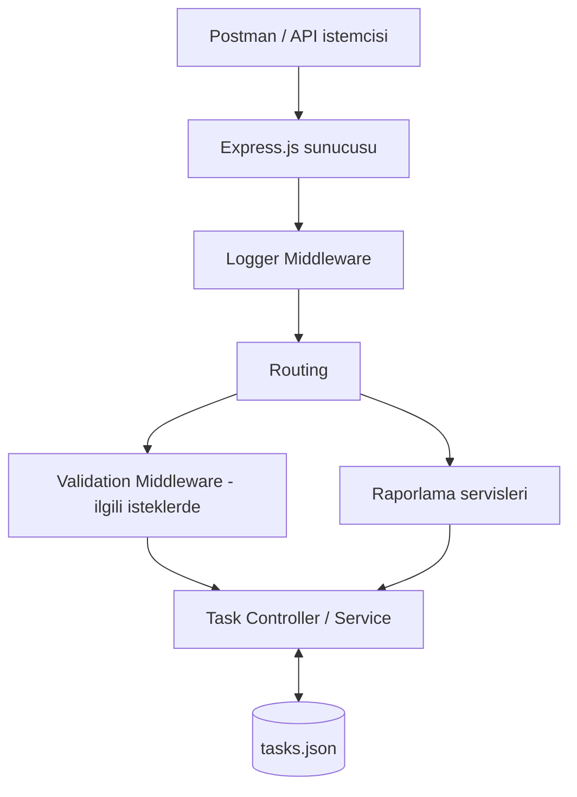
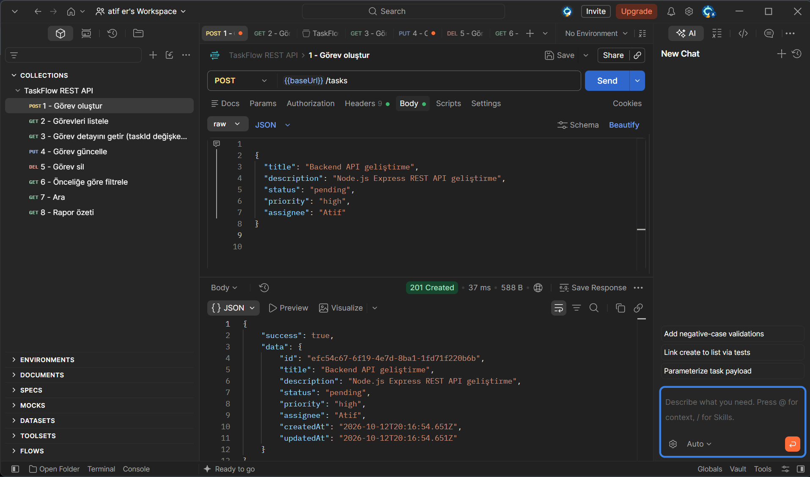
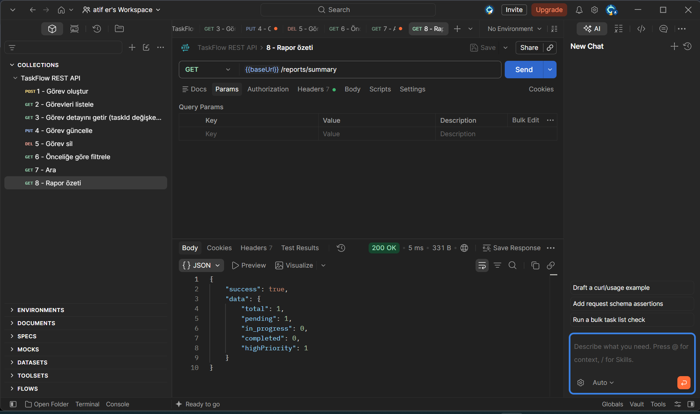
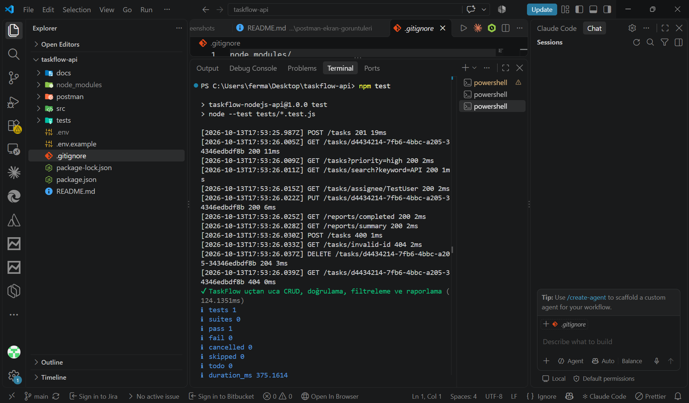

# TaskFlow — Node.js REST API

**Node.js Backend Programlama Bitirme Projesi**

TaskFlow, yazılım ekiplerinin görevlerini oluşturmasına, çalışanlara atamasına, güncellemesine ve takip etmesine yardımcı olan bir **REST API** uygulamasıdır. Node.js ve Express.js ile geliştirilmiştir. Zorunlu CRUD ve Logger Middleware özelliklerine ek olarak arama, filtreleme, sayfalama, doğrulama ve raporlama sunar.

## İçindekiler

- [Özellikler](#özellikler)
- [Kullanılan teknolojiler](#kullanılan-teknolojiler)
- [Sistem mimarisi](#sistem-mimarisi)
- [Kurulum ve çalıştırma](#kurulum-ve-çalıştırma)
- [API uçları](#api-uçları)
- [Örnek API isteği](#örnek-api-isteği)
- [Ekran görüntüleri](#ekran-görüntüleri)
- [Testler ve test kanıtları](#testler-ve-test-kanıtları)
- [Proje dokümanları](#proje-dokümanları)
- [Bilinen sınırlar](#bilinen-sınırlar)

## Özellikler

**Zorunlu eğitim kapsamı**

- Görev oluşturma, listeleme, detay görüntüleme, güncelleme ve silme (CRUD).
- Express.js ile REST API ve routing yapısı.
- Logger Middleware ile HTTP metodu, istek yolu, zaman damgası, HTTP durum kodu ve süre kaydı.
- Postman üzerinden CRUD testleri.

**İsteğe bağlı geliştirmeler**

- Görevlerin durumuna ve önceliğine göre filtrelenmesi.
- Görev arama ve sorumlu çalışana göre listeleme.
- Sayfalama ve sıralama.
- Validation Middleware ile hatalı girişlerin reddedilmesi.
- Tamamlanan, bekleyen ve toplam görev sayısı raporları.
- Node.js ile otomatik API testi.

## Kullanılan teknolojiler

| Teknoloji | Kullanım amacı |
| --- | --- |
| Node.js | Sunucu çalışma ortamı |
| Express.js | REST API ve routing |
| JavaScript | Backend geliştirme |
| JSON ve Node.js `fs` | Görev verilerinin yerel dosyada saklanması |
| Nodemon | Geliştirme sırasında sunucunun yeniden başlatılması |
| Postman | API isteklerinin test edilmesi |
| Git ve GitHub | Sürüm kontrolü ve teslim |

## Sistem mimarisi



İstemci HTTP isteğini gönderir; Express uygulaması isteği ilgili route'a iletir. Görev işlemleri veri dosyasında gerçekleştirilir ve sonuç JSON olarak döndürülür. Logger Middleware istekleri konsola kaydeder.

## Kurulum ve çalıştırma

**Gereksinimler:** Node.js 18 veya üzeri, npm. Geliştirme ve API testleri için VS Code ve Postman önerilir.

Windows / PowerShell terminalinde:

```powershell
git clone https://github.com/atifer349/taskflow-nodejs-api.git
cd taskflow-nodejs-api

node -v
npm -v
npm install
Copy-Item .env.example .env
npm run dev
```

Sunucu açıldığında `http://localhost:3000` adresini ziyaret edebilirsiniz. Sunucuyu durdurmak için terminalde `Ctrl + C` kullanın.

| Komut | Açıklama |
| --- | --- |
| `npm run dev` | Nodemon ile geliştirme sunucusunu başlatır. |
| `npm start` | Normal sunucuyu başlatır. |
| `npm test` | Otomatik API testlerini çalıştırır. |

## API uçları

**Temel CRUD**

| Metot | Endpoint | İşlem | Beklenen başarılı HTTP kodu |
| --- | --- | --- | --- |
| POST | `/tasks` | Görev oluşturma | 201 |
| GET | `/tasks` | Görev listeleme | 200 |
| GET | `/tasks/:id` | Görev detayı | 200 |
| PUT | `/tasks/:id` | Görev güncelleme | 200 |
| DELETE | `/tasks/:id` | Görev silme | 204 |

**Gelişmiş özellikler**

| Metot | Endpoint | İşlem |
| --- | --- | --- |
| GET | `/tasks?status=pending&priority=high` | Durum ve öncelik filtreleme |
| GET | `/tasks?sort=-createdAt&page=1&limit=10` | Sıralama ve sayfalama |
| GET | `/tasks/search?keyword=API` | Görev arama |
| GET | `/tasks/assignee/Musa` | Çalışana göre listeleme |
| GET | `/reports/completed` | Tamamlanan görev sayısı |
| GET | `/reports/pending` | Bekleyen görev sayısı |
| GET | `/reports/summary` | Genel görev özeti |

API tasarım ayrıntıları: [API dokümantasyonu](docs/api-dokumantasyonu.md).

## Örnek API isteği

**POST** `http://localhost:3000/tasks`

Header: `Content-Type: application/json`

Body → raw → JSON:

```json
{
  "title": "Node.js API geliştir",
  "description": "Görev servisini oluştur",
  "status": "pending",
  "priority": "high",
  "assignee": "Musa"
}
```

Başarılı istek `201 Created` yanıtı ve `data` nesnesinde yeni görev bilgilerini döndürür. Yanıttaki `data.id` değeri ile GET, PUT ve DELETE işlemleri yapılabilir.

## Ekran görüntüleri

**Görev oluşturma — POST /tasks (201 Created)**



**Görev raporu — GET /reports/summary (200 OK)**



**Otomatik test çalıştırma sonucu**



Tüm görseller: [Test kanıtları klasörü](docs/postman-ekran-goruntuleri/).

## Testler ve test kanıtları

Postman ile beş temel CRUD isteği, filtreleme, arama ve raporlama test edildi. Boş başlık ve geçersiz öncelik senaryolarında `400 Bad Request` alınması **beklenen doğru davranıştır**. Görev silme işleminde `204 No Content` yanıtının gövdesi boştur.

| No | Kanıt | Kontrol edilen özellik |
| --- | --- | --- |
| 01 | [Görev oluşturma](docs/postman-ekran-goruntuleri/01-gorev-olusturma.png) | POST /tasks — 201 |
| 02 | [Görev listeleme](docs/postman-ekran-goruntuleri/02-gorev-listeleme.png) | GET /tasks — 200 |
| 03 | [Görev detayı](docs/postman-ekran-goruntuleri/03-gorev-detayi.png) | GET /tasks/:id — 200 |
| 04 | [Görev güncelleme](docs/postman-ekran-goruntuleri/04-gorev-guncelleme.png) | PUT /tasks/:id — 200 |
| 05 | [Görev silme](docs/postman-ekran-goruntuleri/05-gorev-silme.png) | DELETE /tasks/:id — 204 |
| 06 | [Logger Middleware](docs/postman-ekran-goruntuleri/06-logger-middleware.png) | Terminalde istek logları |
| 07 | [Öncelik filtreleme](docs/postman-ekran-goruntuleri/07-oncelik-filtreleme.png) | priority=high — 200 |
| 08 | [Görev arama](docs/postman-ekran-goruntuleri/08-gorev-arama.png) | keyword=Backend — 200 |
| 09 | [Raporlama](docs/postman-ekran-goruntuleri/09-raporlama.png) | GET /reports/summary — 200 |
| 10 | [Boş başlık doğrulaması](docs/postman-ekran-goruntuleri/10-validation-bos-baslik.png) | Hatalı title — 400 |
| 11 | [Geçersiz öncelik](docs/postman-ekran-goruntuleri/11-validation-oncelik.png) | priority=urgent — 400 |
| 12 | [Otomatik testler](docs/postman-ekran-goruntuleri/12-otomatik-testler.png) | `npm test` başarılı |

Otomatik testi çalıştırmak için:

```powershell
npm test
```

Son doğrulamada **1 uçtan uca otomatik test geçti, 0 test başarısız oldu**. Bu test içinde birden fazla HTTP isteği yürütülür.

Ayrıca Postman'da içe aktarılabilir koleksiyon: [TaskFlow Postman Collection](postman/TaskFlow.postman_collection.json).

## Proje dokümanları

- [Proje tanıtım dokümanı](docs/proje-tanitim.md)
- [Veri modeli tasarımı](docs/veri-modeli.md)
- [API tasarım dokümanı](docs/api-dokumantasyonu.md)
- [Test görsellerinin açıklama dosyası](docs/postman-ekran-goruntuleri/README.md)

## Bilinen sınırlar

- `tasks.json`, eğitim amacıyla kullanılan yerel JSON veri deposudur; çoklu sunucu ve yüksek trafikli üretim sistemleri için veritabanı önerilir.
- Kullanıcı giriş sistemi ve yetkilendirme bulunmaz. Bu sürümü doğrudan herkese açık üretim ortamında çalıştırmayın.
- `.env` ve `node_modules/` klasörü GitHub'a eklenmez; `.env.example` örnek yapılandırma içerir.

## Teslim

Bu public GitHub deposunda kaynak kodlar, `package.json`, `README.md`, proje tanıtımı, API/veri modeli belgeleri, Postman koleksiyonu ve 12 test kanıtı bulunmaktadır.

**Proje:** [github.com/atifer349/taskflow-nodejs-api](https://github.com/atifer349/taskflow-nodejs-api)
